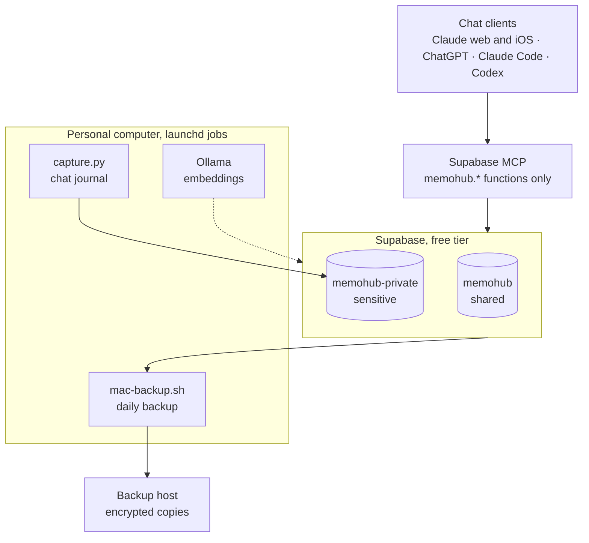

# memohub

Personal memory for AI chats. Summaries and decisions from Claude (web, iPhone, iPad, Desktop,
Claude Code), ChatGPT and Codex go into your own Postgres database, and every connected client
can find them later, including from a phone.

To set it up for yourself, see [docs/INSTALL.md](docs/INSTALL.md).

## How it works

- **Two databases, one schema.** `memohub` is shared and every client connects to it.
  `memohub-private` holds the `medicine` space and other sensitive personal topics. A work
  computer or a company Claude account connects only to `memohub`. The ChatGPT Supabase app is
  granted a whole organization and cannot be narrowed to one project, so ChatGPT sees both; turn
  off training on chats and ChatGPT memory. Rules: [contract](docs/CONTRACT.md#two-databases).
- **Clients call only `memohub.*` functions.** The schema is not exposed through the Data API,
  RLS is on.
- **Client instructions live in the database.** `memohub.guide()` returns them (source:
  `clients/guide.md`, loaded by `scripts/sync-guide.sh`; `--check` catches edits made outside the
  repo). ChatGPT and claude.ai only get a short loader that never needs updating.
- **Catalog:** space (`work`, `personal`, `learning`, `medicine`, `travel`) → project. In `work`
  the project is the git repository or folder name. No project means inbox.
- **Saving** happens on "tomemo": the model writes the summary by the [contract](docs/CONTRACT.md).
  `save` rejects card numbers, IBANs, passport numbers and credentials (`sensitive_data`) and
  refuses `medicine` in the shared database (`private_space`).
- **Reading:** questions about the past go to `memohub.multi_search`, with the user's question and
  2–3 short rephrasings written by the model. Each one runs through Russian full-text search with
  a substring fallback, and the result lists are merged by rank. This works from any client,
  phone and ChatGPT included.
- **Semantic search (optional).** A local Ollama with `embeddinggemma-2:270m` computes note vectors
  (`memohub-index-embeddings.sh`); `memohub-hybrid-search.sh '<query>'` combines vector and
  full-text search. Note text stays on your machines. Without Ollama the script falls back
  to `multi_search`.
- **Files** (PDF, ZIP, documents) go to a private `files` bucket in the same database as the note.
  `check_upload` checks space and duplicates first; text extracted from a file is searchable.
  Company documents are stored as links only. Claude Code command: `/memofile <path>`.
- **Forgetting a note:** `memohub.forget(id)` previews what will go; after a "yes" it deletes every
  version, file, embedding and graph link and keeps a contentless tombstone, so an older backup
  cannot bring the note back. Claude Code command: `/memoforget`.
- **Chat journal:** `scripts/capture.py` collects raw messages from Claude Code, Codex and meeting
  transcripts every 10 minutes (launchd), masks secrets and honours `#nomemo`. A personal computer writes
  to the private database; a work computer sends only selected projects and chats tagged `#memo` to
  the shared one. Search: `memohub.search_captures`.
- **Candidates:** automation may propose notes from the journal; a note is created only when a
  person approves it.

## Development

- `tests/run-local.sh`: all migrations in order plus the smoke test on a throwaway Postgres in Docker.
- `tests/backup-roundtrip.sh`: backup → decrypt → restore into a clean database, table comparison.
- `python3 -I tests/capture_test.py`: the journal scanner on synthetic transcripts, no network.
- `tests/run-eval.sh`: search and dedup eval on the synthetic set `tests/eval/cases.json`
  (hit@1, hit@5, MRR; thresholds are in the script).
- `gitleaks git --redact .`: scans git history for secrets and project coordinates (rules in
  `.gitleaks.toml`). GitHub Actions runs all of the above on every push.
- Leak guard: `git config core.hooksPath .githooks` once per clone. Before every commit and push,
  `scripts/guard.sh` runs gitleaks, checks the added lines and commit messages against a local
  deny list (values from the local config plus your own strings in `~/.memohub/guard.deny`), and
  requires GitHub noreply commit emails. CI cannot see the deny list, so only the local hook
  checks it before anything reaches GitHub.
- Schema changes: `supabase migration new <name>`, tests green, then update `docs/CONTRACT.md`,
  `clients/` and `plugin/` together. `./scripts/db-push.sh` applies migrations to both live
  databases.
- Project links (`supabase/.temp/`, `targets/private/supabase/.temp/`) are local and stay out of git.

## Releases

- Work goes through branches and pull requests; `main` is protected and merges only with green CI.
- A release is a `vX.Y.Z` tag on `main` plus an entry in [CHANGELOG.md](CHANGELOG.md). A plugin
  version is bumped in the same pull request that changes the plugin.
- `./scripts/deploy.sh vX.Y.Z [--migrate]` deploys a tag to the Mac: checkout in `~/.memohub/app`,
  migrations (only with `--migrate`), guide sync, launchd jobs, checks. See
  [docs/INSTALL.md](docs/INSTALL.md#updating).

## File storage

- Free tier limits: 1 GB per database, 50 MB per file (`storage_limit_bytes`, `max_file_bytes`,
  `storage_warn_pct` in `memohub.config`; change them if you change plans).
- Usage: `select memohub.storage_usage()` (also in `catalog().storage`).
- Storage objects themselves are not backed up yet, only notes and file metadata.

## Roadmap

[docs/ROADMAP.md](docs/ROADMAP.md). How the parts fit together: [docs/ARCHITECTURE.md](docs/ARCHITECTURE.md).

## License

[MIT](LICENSE).
