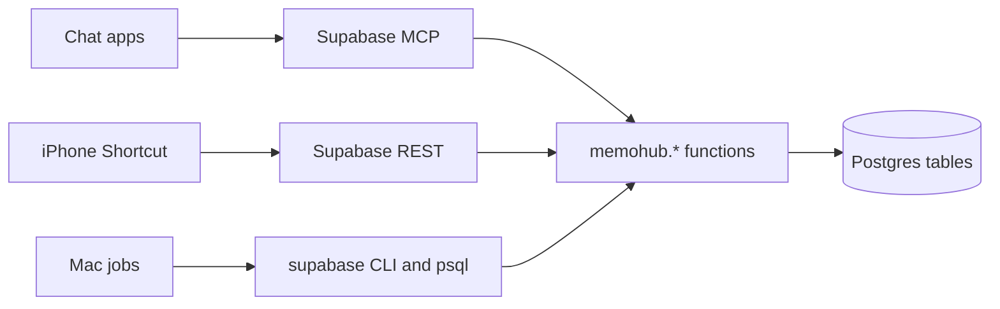

# Architecture

memohub is a Postgres schema with an API made of SQL functions, a set of client texts that tell
chat apps how to call those functions, and a few jobs on a Mac. This note describes the parts,
which of them depend on Supabase, and the convention for adding a feature.

## Parts

| Part | Where | What it does |
|---|---|---|
| Schema `memohub` | `supabase/migrations/` | Tables, privacy guards and the `memohub.*` functions. The functions are the only API; clients never touch tables. |
| Guide | `clients/guide.md`, table `memohub.guides` | The rules for clients. Clients load it with `select memohub.guide()`, so most rule changes need no client update. |
| Client texts and plugins | `clients/`, `plugin/`, `codex-plugin/` | Short loaders for each chat app, plus the Claude Code and Codex plugins with commands and skills. |
| Journal scanner | `scripts/capture.py` | Reads Claude Code and Codex transcripts and meeting notes, masks secrets, sends batches to `memohub.capture_batch`. |
| Backup | `scripts/mac-backup.sh`, `backup/` | Exports both databases as JSON with `psql`, encrypts with `age`, keeps local and optional remote copies. |
| Health report | `scripts/health.py` | Weekly check that every source still delivers. |
| Distiller | `scripts/distill.py` | Nightly: proposes notes from finished chats as candidates for you to approve. Off until a source is allowed. |
| Embeddings | Ollama, `codex-plugin/bin/` | Computed on the client with a local model and stored with `memohub.put_embedding`. Search works without them. |
| Release | `scripts/deploy.sh`, `scripts/guard.sh` | Deploys a tag to `~/.memohub/app`; the guard checks every commit and push for leaks. |

## Two databases

`memohub` (shared) and `memohub-private` run the same migrations. `memohub.config` has
`tier = 'private'` in the private one, and `save()` refuses private spaces such as `medicine`
in the shared database. Work devices connect only to the shared database.
`scripts/db-push.sh` and `scripts/sync-guide.sh` always act on both.

## What depends on Supabase

The schema and functions are plain Postgres with the `vector` and `pg_trgm` extensions. CI runs
every migration on a stock `pgvector/pgvector` image, with two small stubs for the Supabase parts
(`tests/auth_stub.sql`, `tests/storage_stub.sql`).

| Dependency | Used for | Without Supabase |
|---|---|---|
| Hosted MCP (`mcp.supabase.com`) and its OAuth | Every chat client calls `execute_sql` through it. Web and phone apps reach it from the provider's servers. | Needs another MCP server that is reachable from the internet. This is why the shared database stays on Supabase. |
| `auth.uid()` and `memohub.members` | `_require_member()` checks the caller on REST calls. | Replace with a role check or a token table. |
| Storage (`storage.objects`, bucket `files`) | Files attached to notes. The functions check `to_regclass('storage.objects')` and skip file logic when it is absent. | Files would need another store; notes work without it. |
| REST (`/rest/v1/rpc/...`) | The Shortcut's `capture_thought` with a device key. | Any HTTP endpoint that calls the same function. |
| `supabase` CLI and project links | Migrations, guide sync, the scanner's `db query --linked`. | `psql` with a connection string. |

The private database has no phone or web clients, so it can move to plain Postgres first. That
is the "self-hosted private database" item in the roadmap.

## Adding a feature

A feature is a script or a set of SQL functions. A module registry, plugin loader or daemon is
not planned until there is a second user or a second hosting option. Each feature follows the
same convention:

- Config: keys with the feature's prefix in `memohub.config`, for example `distill.allow`.
  Defaults live in the migration that adds the feature.
- Local state: `~/.memohub/<feature>/` (cursors, spool, last run). Losing it causes a rescan,
  never data loss.
- Log: `~/.memohub/<feature>.log` with counts only, no message text.
- Failures: after three failed runs in a row the job pauses and the health report says so.
- Schedule: a launchd job installed by `scripts/install-<feature>.sh` from the release
  checkout. `deploy.sh` reinstalls it only if it is already installed.
- Database writes: only through `memohub.*` functions. Automation proposes notes as
  candidates; a person approves them.
- Models: local Ollama by default. Headless Claude Code (`claude -p`) on a Claude plan, or a
  hosted API with your own key, are options.

The journal scanner follows most of this: `capture.conf`, state in `~/.memohub/capture/`, a log
and a launchd job. It does not pause yet; a failed send keeps the spool and retries on the next
run. The distiller follows all of it: `distill.allow` and `distill.paused` in config,
`distill.conf` and `~/.memohub/distill/`, `distill.log` with counts, a pause after three failed
runs, `install-distill.sh`, and candidates through `_propose()`.
